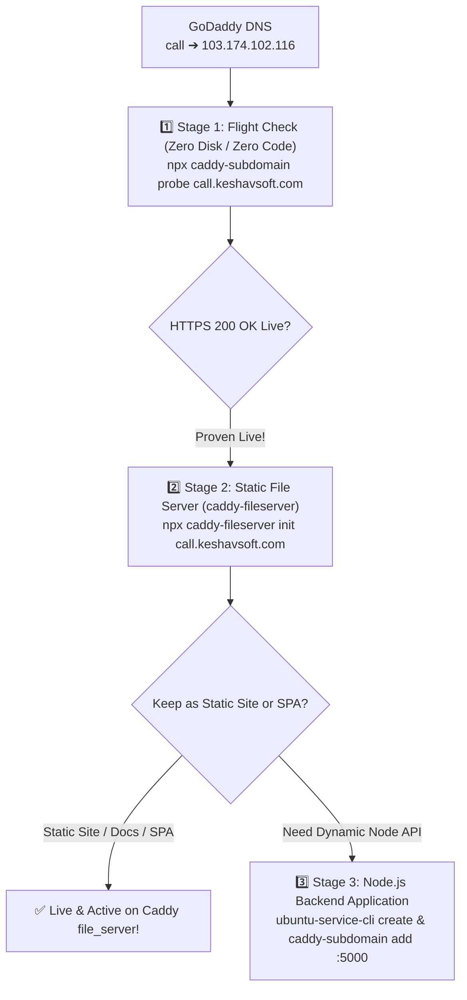

# Caddy Template Knowledge Base

[](https://keshavsoft.github.io/caddy-template-knowledge/)
[](https://github.com/keshavsoft)
[](LICENSE)
[](https://caddyserver.com)

> **The permanent, plain-English handbook explaining Caddy JSON route blueprints, traffic patterns, and zero-downtime VPS hosting.**

Because cloud hosting and reverse proxy configuration are touched only once every few months, this knowledge base eliminates "cold start" amnesia. Open it anytime to understand exactly **why** each template exists, how Caddy routes traffic, and how to onboard a new service without breaking existing sites.

---

## 📖 Live Handbook

Read the full interactive guide with sidebar navigation and syntax highlighting:  
👉 **[https://keshavsoft.github.io/caddy-template-knowledge/](https://keshavsoft.github.io/caddy-template-knowledge/)**

---

## 🏥 Practical Case Study: `appointment-notifier`

Looking to see how this works on a real app? Read the step-by-step code investigation walkthrough:  
👉 **[How to Inspect appointment-notifier & Determine Its Caddy Input](https://keshavsoft.github.io/caddy-template-knowledge/appointment-notifier-guide.html)**

### Summary of the Deduction:
1. **Source Inspection (`app.js`)**: `appointment-notifier` runs an HTTP server on port `3000` and intercepts WebSockets with `server.on("upgrade")` on the **exact same port**.
2. **Frontend Inspection (`display.js`)**: Connects dynamically to `wss://${location.host}/ws` on standard port 443.
3. **Template Choice**: **`proxy`** is selected because Caddy natively converts HTTP upgrade headers into WebSocket streaming tunnels on the single dial port (`localhost:3000`). (Choosing `ws-split` would be wrong because there is no second port!).
4. **Command to Run**:
   ```bash
   npx caddy-template proxy appointment.keshavsoft.com 3000
   ```

---

## 🧭 Quick Template Selector

Use this decision matrix to pick the right template in 5 seconds:

| If your application looks like this... | Use this template | Real KeshavSoft Example |
| :--- | :--- | :--- |
| **Unified Node/Express app** where HTTP and WebSockets share one port | **`proxy`** | `appointment.keshavsoft.com` (:3000) |
| **Split engine** where WebSockets run on one port (:8080) and REST on another (:9011) | **`ws-split`** | `quotation.keshavsoft.com` (:8080 & :9011) |
| **Static files** (HTML, CSS, JS, assets) with no Node.js backend process | **`static`** | `cli.keshavsoft.com` (/usr/share/...) |
| **Primary domain and aliases** (e.g. apex domain + `www`) | **`multi-host`** | `keshavsoft.com, www.keshavsoft.com` (:9328) |

---

## ⚡ The 4 Production Templates Deep-Dive

### 1. `proxy` (Unified HTTP & WebSocket)
```bash
npx caddy-template proxy appointment.keshavsoft.com 3000
```
* **Architecture:**
  ```
  Browser (HTTPS / WSS) ──:443──► Caddy Reverse Proxy ──:3000──► Node.js App
                                  (Auto TLS + WebSocket Upgrade)
  ```
* **Why it works:** Modern Node.js apps (like `appointment-notifier`) attach WebSocket servers to the existing HTTP listener. Caddy automatically inspects the `Upgrade: websocket` header and tunnels the connection to `localhost:3000` with zero configuration needed.

---

### 2. `ws-split` (Dual-Target Split Proxy)
```bash
npx caddy-template ws-split quotation.keshavsoft.com 9011 8080
```
* **Architecture:**
  ```
  Browser Request ──► Caddy ──┬── /ws or /ws/* ──────────────► localhost:8080 (WS Server)
                              └── All other paths (*) ────────► localhost:9011 (Web/API Server)
  ```
* **Why it works:** Evaluates path matches inside a `subroute`. Any request matching `/ws` or `/ws/*` routes to port `8080`. All other requests fall through to port `9011`.

---

### 3. `static` (Direct File Server)
```bash
npx caddy-template static cli.keshavsoft.com /usr/share/caddy
```
* **Architecture:**
  ```
  Browser ──:443──► Caddy ──► Local Filesystem (/usr/share/caddy)
  ```
* **Why it works:** Uses Caddy's native `vars.root` and `file_server` handlers. Zero-copy kernel file transfer with automatic ETag generation and Gzip/Zstandard compression without touching Node.js.

---

### 4. `multi-host` (Domain Aliases)
```bash
npx caddy-template multi-host keshavsoft.com,www.keshavsoft.com 9328
```
* **Why it works:** Binds an array of hosts to a single upstream. Caddy obtains and manages TLS certificates for all listed domains automatically.

---

## 🔍 Caddy JSON Anatomy: Plain-English Reference

| JSON Property | What It Means | Why It Matters |
| :--- | :--- | :--- |
| `match[].host` | Array of domain names | Triggers route and initiates automatic TLS certificate generation. |
| `handler: "subroute"` | Isolated routing box | Prevents rules for one domain from conflicting with other domains. |
| `handler: "reverse_proxy"` | Internal proxy module | Streams client traffic to your backend process. |
| `upstreams[].dial` | Target address (e.g. `localhost:3000`) | The internal port where your app is listening. |
| `terminal: true` | Stop evaluation flag | **Essential!** Tells Caddy to stop checking subsequent rules once this route matches. |

---

## 📋 5-Minute "Cold Start" Hosting Checklist

When returning to the server 3 months from now, follow these 4 steps:

1. **Check Occupied Ports:**
   ```bash
   npx caddy-cli -p /etc/caddy/caddy.json
   ```
2. **Generate Route Blueprint:**
   ```bash
   npx caddy-template proxy yourdomain.keshavsoft.com 3000
   ```
3. **Paste into `/etc/caddy/caddy.json`:**
   Insert into the `apps.http.servers.srv0.routes` array.
4. **Reload Caddy with Zero Downtime:**
   ```bash
   caddy reload --config /etc/caddy/caddy.json
   ```

---

## 🛠️ Common Gotchas

1. **DNS A-Record First:** Ensure your subdomain points to the VPS IP (`103.174.102.116`) before reloading Caddy, or the ACME challenge will fail.
2. **Never Omit `terminal: true`:** Without this flag, requests might fall through to downstream catch-all routes.
3. **Single-Port Apps Don't Need `ws-split`:** If HTTP and WebSockets share one port (e.g. `appointment-notifier`), standard `proxy` is simpler and faster.

---

## ⚡ The Story: Why We Transitioned to Native JSON

According to the [official Caddy architecture documentation](https://caddyserver.com/docs/getting-started#the-caddyfile-is-an-adapter), **the Caddyfile is only an adapter**.

| Paradigm | [Caddyfile Adapter](https://caddyserver.com/docs/caddyfile) | [Native Caddy JSON](https://caddyserver.com/docs/json/) |
| :--- | :--- | :--- |
| **Primary Use** | Manual text editing | True source of truth |
| **API Support** | Static, requires file reload | Full zero-downtime [Caddy Admin API](https://caddyserver.com/docs/api) (`:2019`) |
| **Fleet Automation** | Fragile regex string parsing (`sed`) | Safe, programmatic JSON AST manipulation |
| **Active WebSockets** | Risk of dropped sockets via systemctl | Preserved in-memory across hot reloads |

**Why this handbook exists:** When returning to reverse proxy configuration after months of focusing on application features, developers experience "cold-start amnesia". Hand-crafting nested JSON ASTs (`match ➔ handle ➔ subroute ➔ routes ➔ handle ➔ reverse_proxy ➔ upstreams ➔ dial`) invites syntax mistakes. This handbook provides plain-English blueprints, visual traffic diagrams, and practical checklists.

---

## 🧭 The 3-Stage VPS Subdomain Maturity Model

Never configure DNS, Node.js ports, Caddy routes, and SSL simultaneously. KeshavSoft decouples hosting into three progressive verification stages:



---

## 📚 The KeshavSoft Caddy Suite Ecosystem

| Repository | Responsibility | npm / Docs | Key Command |
| :--- | :--- | :--- | :--- |
| **[`caddy-cli`](https://github.com/keshavsoft/caddy-cli)** | Observability & Port Mapping | [](https://www.npmjs.com/package/caddy-cli) | `npx caddy-cli -p` |
| **[`caddy-template`](https://github.com/keshavsoft/caddy-template)** | Route Blueprint Generation | [](https://www.npmjs.com/package/caddy-template) | `npx caddy-template proxy <host> <port>` |
| **[`caddy-subdomain`](https://github.com/keshavsoft/caddy-subdomain)** | Smoke Probes & Promotion | [](https://www.npmjs.com/package/caddy-subdomain) | `npx caddy-subdomain probe <host>` |
| **[`caddy-fileserver`](https://github.com/keshavsoft/caddy-fileserver)** | Ubuntu Filesystem Bridge | [](https://www.npmjs.com/package/caddy-fileserver) | `npx caddy-fileserver init <host>` |
| **[`caddy-knowledge`](https://github.com/keshavsoft/caddy-knowledge)** | Master Architectural Handbook | [Live Handbook](https://keshavsoft.github.io/caddy-knowledge/) | Full Suite Reference |
| **[`caddy-template-knowledge`](https://github.com/keshavsoft/caddy-template-knowledge)** | Route Blueprint Manual | [Live Manual](https://keshavsoft.github.io/caddy-template-knowledge/) | AST Deep-Dives |
| **[`caddy-hosting`](https://github.com/keshavsoft/caddy-hosting)** | Unified Gateway & Hub | [Live Portal](https://keshavsoft.github.io/caddy-hosting/) | Gateway Hub |
| **[`appointment-notifier`](https://github.com/keshavsoft/appointment-notifier)** | Real-world Production App | [GitHub Repo](https://github.com/keshavsoft/appointment-notifier) | Real-time WS calling |

---

## 📄 License

ISC © [KeshavSoft](https://github.com/keshavsoft)

